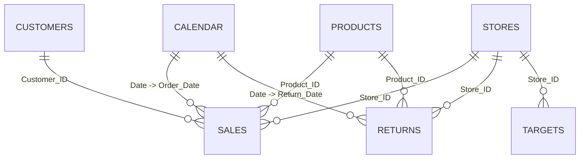

# Sales Performance Dashboard (Q1 2025) | Power BI

!\[Sales Performance Dashboard](Sales\_Performance\_Dashboard.png)

An end-to-end Power BI project: raw multi-sheet Excel data cleaned in Power Query, modelled as a star schema, analysed with DAX, and presented in a single-page interactive dashboard.

> \*\*Dataset note:\*\* This is a practice dataset (Customers, Products, Stores, Calendar, monthly Sales, Returns, Targets) used to build job-style analytics skills. All numbers below were verified against the source file.

\---

## Table of Contents

1. [Project Overview](#1-project-overview)
2. [Business Questions](#2-business-questions)
3. [Dataset](#3-dataset)
4. [Tools and Skills Used](#4-tools-and-skills-used)
5. [Project Workflow](#5-project-workflow)
6. [Data Cleaning (Power Query)](#6-data-cleaning-power-query)
7. [Append (Combining Monthly Sales)](#7-append-combining-monthly-sales)
8. [Data Model](#8-data-model)
9. [DAX Measures](#9-dax-measures)
10. [Dashboard Design](#10-dashboard-design)
11. [Interactivity](#11-interactivity)
12. [Key Insights](#12-key-insights)
13. [Challenges and How I Solved Them](#13-challenges-and-how-i-solved-them)
14. [How to Open the Project](#14-how-to-open-the-project)
15. [Project Structure](#15-project-structure)
16. [Limitations and Future Improvements](#16-limitations-and-future-improvements)
17. [What I Learned](#17-what-i-learned)

\---

## 1\. Project Overview

|Item|Detail|
|-|-|
|Goal|Build a decision-ready sales dashboard from messy raw Excel data|
|Period covered|1 Jan 2025 to 31 Mar 2025 (Q1)|
|Raw tables|9 (Customers, Products, Stores, Calendar, Sales Jan/Feb/Mar, Returns, Targets)|
|Final model|7 tables, star schema|
|Sales rows|420 orders (after removing 1 duplicate)|
|Output|One-page interactive dashboard (Full HD, 1920 x 1080)|

**Headline numbers (verified):**

|Metric|Value|
|-|-|
|Total Sales|15,538,016 (15.54M)|
|Total Profit|3,882,185.54 (3.88M)|
|Profit Margin|24.99%|
|Total Target|40,813,000 (40.81M)|
|Target Achievement|38.07%|

\---

## 2\. Business Questions

The dashboard is built to answer:

1. How much did we sell, and how profitable was it?
2. How are sales trending month by month and day by day?
3. Which product categories drive the revenue?
4. Which stores perform best, in sales and in margin?
5. How far are we from the sales target?
6. Can a manager filter by month, region, channel and store without any technical help?

\---

## 3\. Dataset

Source file: `PowerBI\_Practice\_Dataset\_With\_Data\_Visible.xlsx`

|Table|Rows|Role|Key column|
|-|-|-|-|
|Customers|80|Dimension|Customer\_ID|
|Products|45|Dimension|Product\_ID|
|Stores|8|Dimension|Store\_ID|
|Calendar|90|Dimension (Jan to Mar 2025)|Date|
|Sales\_Jan\_Raw|141|Fact (raw)|Order\_ID|
|Sales\_Feb\_Raw|140|Fact (raw)|Order\_ID|
|Sales\_Mar\_Raw|140|Fact (raw)|Order\_ID|
|Returns|55|Fact|Order\_ID|
|Targets|24 (8 stores x 3 months)|Fact|Store\_ID + YearMonth|

**Sales columns:** Order\_ID, Order\_Date, Customer\_ID, Product\_ID, Store\_ID, Quantity, Unit\_Price, Discount\_Pct, Sales\_Amount, Cost\_Amount, Payment\_Mode, Channel, Region, Salesperson.

\---

## 4\. Tools and Skills Used

* **Power BI Desktop** (Power Query, Data Model, Report view)
* **DAX** (SUM, SUMX, DIVIDE, CALCULATE, MAX, DATESBETWEEN, DATESMTD, DATESQTD, DATESYTD)
* **Data cleaning:** profiling, Trim/Clean, null handling, duplicates, type validation, business-rule validation
* **Data modelling:** star schema, one-to-many relationships, active vs inactive relationships
* **Visualisation and design:** grid layout, consistent typography, slicers, bookmarks, edit interactions

\---

## 5\. Project Workflow

```
Raw Excel (9 sheets)
      |
      v
Power Query: profile -> clean -> validate (each table)
      |
      v
Append: Sales\_Jan + Sales\_Feb + Sales\_Mar -> Sales (420 rows)
      |
      v
Data Model: star schema, 8 active relationships
      |
      v
DAX: measures (sales, profit, margin, MTD/QTD/YTD ...)
      |
      v
Visuals (practice pages) -> final one-page Dashboard
```

Cleaning always came first, then Append, then Modelling, then DAX, then Visuals, then the Dashboard.

\---

## 6\. Data Cleaning (Power Query)

Every table went through the same checklist, in this order:

1. **Profiling:** Column quality, Column distribution, Column profile (entire dataset, not top 1,000 rows)
2. **Data types:** verify each column (Text, Date, Whole number, Decimal)
3. **Text cleaning:** Trim, then Clean, on text columns only (never on dates or numbers)
4. **Nulls and blanks:** investigate first, decide second
5. **Errors:** Keep Errors to check, then remove the temporary step
6. **Duplicates:** checked on the **key column only**
7. **Numeric validation:** Min / Max, negative or zero values, extra-zero typos
8. **Date validation:** type and Min / Max must match the month
9. **Business rules:** formula checks with temporary custom columns
10. **Final organisation:** meaningful step names, no leftover temporary steps

### Issues found in the data and how each was fixed

|Table|Issue found|Decision and fix|Why|
|-|-|-|-|
|Sales (all 3 months)|`Region` had leading/trailing spaces (for example `" West "`)|Trim + Clean on all text columns|`"West"` and `" West "` are different values, which splits totals and slicers|
|Sales (all 3 months)|`Payment\_Mode` had 3 nulls per month|Replaced `null` with `"Unknown"`|The orders are valid and have sales amounts. Deleting rows would reduce total sales, and guessing Cash/UPI would invent data|
|Sales Jan|1 exact duplicate row (`ORD010026`)|Remove Duplicates on `Order\_ID` only|A duplicated order double-counts 10,000 in sales. Row count 141 to 140|
|Sales Mar|`Order\_Date` loaded as a whole number (Excel serial, for example 45735)|Changed type to Date|Date DAX and the Calendar relationship need a real Date type|
|Sales Feb and Mar|`Unit\_Price` and `Sales\_Amount` auto-detected as Whole number|Set to Decimal|Keeps the same type as January, so Append is clean and prices with decimals are never rounded|
|Customers, Products, Stores, Calendar, Returns, Targets|No nulls, errors or duplicates in key columns (verified)|Trim/Clean and type checks as routine|Keys used in relationships must have no hidden spaces|
|Calendar|All columns arrived as "Any" type|Date, Whole number and Text types set explicitly|Needed for relationships and sorting|

### Business-rule validations (all passed)

|Rule|Check|Result|
|-|-|-|
|Sales amount|`Quantity x Unit\_Price x (1 - Discount\_Pct) - Sales\_Amount`|0 for every row (Jan, Feb, Mar)|
|Profit sanity|`Sales\_Amount - Cost\_Amount`|Always positive (Jan minimum 57.55)|
|Product margin|`Unit\_Price - Unit\_Cost`|Always positive|
|Dates|Min / Max per month|Jan 1 to Jan 31, Feb 1 to Feb 28, Mar 1 to Mar 31|
|Quantity|Min / Max|1 to 6|
|Discount|Min / Max|0 to 0.15 (kept as a decimal, formatted as % only for display)|

### Why these decisions matter (analyst thinking)

* **Do not delete what you do not understand.** A null `Payment\_Mode` did not invalidate the order.
* **Duplicates are checked on the key (Order\_ID), not on every column.** A customer, product, store or region can legitimately repeat.
* **Validate with the data's own rules**, not with assumptions.

\---

## 7\. Append (Combining Monthly Sales)

`Sales\_Jan\_Raw + Sales\_Feb\_Raw + Sales\_Mar\_Raw` were combined with **Append Queries as New** into one `Sales` table.

|Check|Result|
|-|-|
|Rows|140 + 140 + 140 = **420**|
|Columns|14|
|`Order\_ID`|Count = Distinct = Unique = 420|
|`Order\_Date`|Date type, Min 1 Jan 2025, Max 31 Mar 2025|

The three raw queries have **Enable load OFF** (and Include in report refresh ON), so the model contains only the final `Sales` table while refresh still works.

**Why append:** one fact table is easier to model, and totals, trends and comparisons across months need all months in one place.

\---

## 8\. Data Model

A **star schema** with 4 dimension tables and 3 fact tables.



### Relationships

|From (1 side)|To (many side)|Status|
|-|-|-|
|Calendar\[Date]|Sales\[Order\_Date]|Active|
|Calendar\[Date]|Returns\[Return\_Date]|Active|
|Customers\[Customer\_ID]|Sales\[Customer\_ID]|Active|
|Products\[Product\_ID]|Sales\[Product\_ID]|Active|
|Products\[Product\_ID]|Returns\[Product\_ID]|Active|
|Stores\[Store\_ID]|Sales\[Store\_ID]|Active|
|Stores\[Store\_ID]|Returns\[Store\_ID]|Active|
|Stores\[Store\_ID]|Targets\[Store\_ID]|Active|
|Returns\[Order\_ID]|Sales\[Order\_ID] (1:1)|**Inactive**|

All relationships are one-to-many with single-direction filtering (dimension to fact).

### Modelling decisions

* **Primary key = the column where every value appears once** (Customer\_ID in Customers, Date in Calendar). The matching column in a fact table is the foreign key and repeats.
* **A wrong auto-detected relationship was deleted:** Power BI linked `Customers\[City]` to `Stores\[City]`. City is not a key, and it created a second path from Sales to Stores that deactivated the correct one.
* **`Returns\[Order\_ID]` to `Sales\[Order\_ID]` stays inactive.** Activating it would give Returns two paths to Products and Stores (ambiguity). It can be used on demand with `USERELATIONSHIP`.
* **`Calendar\[Month\_Name]` is sorted by `Month\_Number`**, otherwise months appear alphabetically (February, January, March).
* **Targets connect only through Stores.** This has a consequence for the dashboard (see Section 11).

\---

## 9\. DAX Measures

### Base measures

```DAX
Total sales = SUMX(Sales, Sales\[Quantity] \* Sales\[Unit\_Price] \* (1 - Sales\[Discount\_Pct]))
```

Iterates row by row (row context) and then adds up. Result: 15,538,016.

```DAX
Profit (calculated column) = Sales\[Sales\_Amount] - Sales\[Cost\_Amount]
Total Profit = SUM(Sales\[Profit])
```

Profit is a per-row value, so it is a **calculated column**. The total is a **measure**. Result: 3,882,185.54.

```DAX
Profit margin % = DIVIDE(\[Total Profit], \[Total sales])
```

`DIVIDE` returns blank instead of an error when the denominator is zero. Result: 24.99%.

### Filter-context measures (CALCULATE)

```DAX
Online Sales = CALCULATE(\[Total sales], Sales\[Channel] = "Online")
```

Adds a filter on top of the current context. Result: 7,763,246.

```DAX
North Online Sales = CALCULATE(\[Total sales], Sales\[Channel] = "Online", Sales\[Region] = "North")
```

Multiple filters in `CALCULATE` behave as AND. Result: 2,942,585.

```DAX
Latest Monthly Sales = CALCULATE(\[Total sales], Calendar\[Month\_Number] = MAX(Calendar\[Month\_Number]))
```

`MAX` finds the latest month in the current selection (3 = March), then `CALCULATE` filters to that month. Result: 5,097,317. Selecting February in the slicer returns 5,859,961.

### Time intelligence

```DAX
Sales 15Jan to 15Feb = CALCULATE(\[Total sales], DATESBETWEEN(Calendar\[Date], DATE(2025,1,15), DATE(2025,2,15)))
MTD Sales = CALCULATE(\[Total sales], DATESMTD(Calendar\[Date]))
QTD Sales = CALCULATE(\[Total sales], DATESQTD(Calendar\[Date]))
YTD Sales = CALCULATE(\[Total sales], DATESYTD(Calendar\[Date]))
```

|Measure|Result|
|-|-|
|Sales 15 Jan to 15 Feb|5,006,273|
|MTD at 31 Mar|5,097,317|
|QTD / YTD at 31 Mar|15,538,016|

### Measure vs calculated column (rule I follow)

* **Calculated column:** every row needs its own value, or the value is used for slicing/filtering. Row context. Stored in the table.
* **Measure:** one number for the current selection. Filter context. Calculated when the report is used.
* A measure cannot refer to `Sales\[Sales\_Amount]` alone, because DAX does not know which row to use. It needs an aggregation (`SUM`, `MAX`) or an iterator (`SUMX`).

\---

## 10\. Dashboard Design

**Canvas:** Full HD, 1920 x 1080. Light grey background, white visuals, one blue colour family, one red marker (target only).

### Layout grid (margin 30, gap 20)

Width of each visual in a row: `(1860 - (n - 1) x 20) / n`

|Row|Content|
|-|-|
|Row 1|Title, Reset button, Store dropdown, Channel, Region, Month slicers|
|Row 2|4 KPI cards: Total sales, Total Profit, Profit margin %, Latest Monthly Sales|
|Row 3|Daily Sales Trend (line), Sales by Category (bar)|
|Row 4|Sales vs Target (gauge), Store Performance (table), Monthly Sales (column)|

### Visual choices and reasons

|Visual|Why this visual|
|-|-|
|Cards|One headline number each, instantly readable|
|Line chart (daily)|Trend over time, spike detection|
|Bar chart (category)|Ranking of categories with long names|
|Column chart (monthly)|Compare 3 months side by side|
|Gauge|Actual vs target at a glance|
|Table (stores)|Exact numbers: sales, profit, margin per store, sorted high to low|

### Design rules applied

1. Same left and right edges on every row, equal gaps
2. One font family, a clear size hierarchy (title 28, card value 40, chart title 16, axis 12 to 14)
3. Chart titles left-aligned and consistent
4. Number formats: M for cards, thousands separators for the table, percentage for margin
5. A short subtitle on the trend chart explains the spike

\---

## 11\. Interactivity

* **Slicers:** Store (dropdown), Channel, Region, Month (button slicers). A blank item that appeared in the button slicers was hidden through the Filters pane.
* **Reset button:** a Bookmark ("Reset View") captured in the clean state and linked to a button. It clears slicers and chart selections in one click (Ctrl + click in Desktop).
* **Edit interactions:** Month and Channel slicers are set to **None** on the Gauge.

### Why the Gauge ignores Month and Channel

The Gauge compares `Total sales` (from the Sales table) with `Target` (from the Targets table). Region and Store slicers filter **both** tables because both connect to `Stores`. Month (via Calendar) and Channel (a Sales column) filter **only Sales**. Without the interaction change, picking February would compare February sales (5.86M) with the full-quarter target (40.81M), which is a misleading comparison.

\---

## 12\. Key Insights

|#|Insight|Evidence|
|-|-|-|
|1|**Electronics drives the business**|8.40M of 15.54M sales, about 54%|
|2|**February was the strongest month**|Jan 4.58M, **Feb 5.86M** (+27.9% vs Jan), Mar 5.10M (-13.0% vs Feb)|
|3|**One huge sales day**|24 Feb 2025 = 1,020,450, far above any other day|
|4|**Top store is Pune Mall**|3.33M, about 21% of all sales|
|5|**Highest sales is not highest margin**|Ahmedabad Plaza has the best margin (28.20%) but ranks 6th in sales. Hyderabad Main (21.73%) and Jaipur Central (21.46%) have the weakest margins|
|6|**Category margins differ**|Electronics has the lowest margin (23.90%) despite the highest sales. Clothing has the highest (28.08%)|
|7|**Regional momentum is opposite**|North grew from 1.17M (Jan) to 2.63M (Mar), about +125%. West fell from 2.43M to 1.50M, about -38%|
|8|**Channels are balanced**|Store 50.04% (7.77M) vs Online 49.96% (7.76M)|
|9|**Target gap**|Q1 sales reached 38.07% of the total target (15.54M of 40.81M)|
|10|**Returns**|55 returned orders (about 13% of 420 orders), rising by month: Jan 14, Feb 16, Mar 25|

\---

## 13\. Challenges and How I Solved Them

|Challenge|Solution|
|-|-|
|Duplicate order and hidden spaces gave wrong totals|Profiling first, then Trim/Clean and Remove Duplicates on the key|
|March dates were serial numbers|Changed to Date type and verified Min / Max|
|Auto-detected data types differed between months|Set types explicitly before Append|
|Auto-created wrong relationship (City to City)|Removed it, kept only key-based relationships|
|Blank (`--`) tile in slicers|Hid it using the Filters pane (basic filtering)|
|Leftover filter copied from another slicer|Removed the stale visual-level filter|
|`single value cannot be determined` DAX error|Understood row context vs filter context: used a calculated column (or SUMX) instead of a measure referencing a bare column|
|KPI visual did not match card styling|Replaced it with a Card driven by a `CALCULATE` + `MAX` measure|
|Gauge compared mismatched filters|Edit interactions set to None for Month and Channel|
|Layout looked uneven on a Full HD canvas|Used a margin / gap / width formula and exact Size and Position values|
|Some classic slicers ignored font size settings|Rebuilt them as button slicers copied from a well-formatted one|

\---

## 14\. How to Open the Project

1. Install Power BI Desktop (free).
2. Keep the Excel dataset and the `.pbix` file in the **same fixed folder**. Power BI stores the file path, so moving or renaming the Excel file breaks the refresh. If that happens: Home, Transform data, Data source settings, Change Source.
3. Open the `.pbix`. The dashboard is on the page named **Sales dashboard**.
4. To use the dashboard: pick slicers, click chart elements to cross-filter, and press **Reset** (Ctrl + click in Desktop) to clear everything.

\---

## 15\. Project Structure

```
03-sales-performance-dashboard/
|-- README.md
|-- Sales\_Performance\_Dashboard.png
|-- Data/
|   `-- PowerBI\_Practice\_Dataset\_With\_Data\_Visible.xlsx
`-- PowerBi/
    `-- Sales\_Practice.pbix
```

\---

## 16\. Limitations and Future Improvements

**Limitations**

* Only one quarter (Jan to Mar 2025), so year-over-year DAX (`SAMEPERIODLASTYEAR`) cannot be demonstrated.
* Targets connect to Stores only, so a month-wise Target vs Actual comparison is not available yet.
* The trend-chart subtitle ("Peak day") is static text and does not change with slicers.

**Future improvements**

* Link `Targets\[YearMonth]` to the calendar (many-to-many or a month dimension) for month-wise Target vs Actual.
* Add Returns analysis (return rate by product and store) with `USERELATIONSHIP`.
* Month-over-month growth with `PREVIOUSMONTH` and `DATEADD`.
* Dynamic peak-day measure for the subtitle.
* Rebuild the same cleaning in **SQL** and **Python (pandas)** and compare.
* Row-level security and publishing to Power BI Service.

\---

## 17\. What I Learned

* Profile the data **before** cleaning. Decide from the actual values, not assumptions.
* Check duplicates on the **key**, never on columns that legitimately repeat.
* A wrong relationship produces wrong numbers silently, so every relationship needs a primary key to foreign key reason.
* Filter context decides what a measure returns. `CALCULATE` changes that context.
* Always check whether two numbers on a visual are filtered by the **same** slicers (the Gauge lesson).
* Layout is arithmetic: margin, gap and width formulas give a professional grid.
* Verify every dashboard number against the source file.

\---

## Author

**Farhan Ansari** | Aspiring Data Analyst
GitHub: `farhanansari7979` | LinkedIn: `Farhan Ansari`

